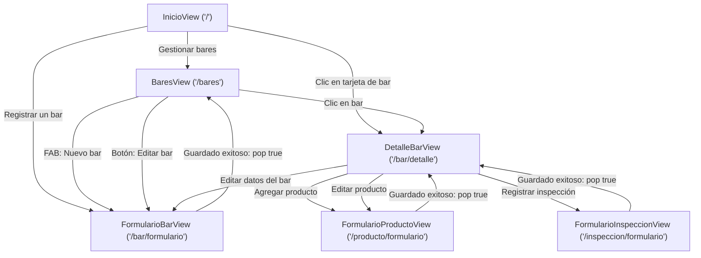
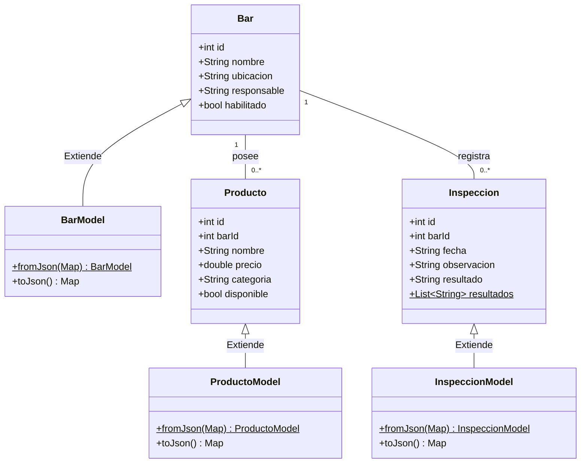

# Documentación Técnica y Arquitectónica del Sistema: Bares Universitarios

**Fecha de generación:** 19 de noviembre de 2026  
**Autor del informe:** Arquitecto de Software Senior Flutter/Dart y Documentador Técnico  
**Estado de la auditoría:** Análisis exhaustivo estático completado (código fuente, configuración, plataformas, assets y pruebas).

> [!NOTE]
> **Aviso de elementos no encontrados o no determinables en el repositorio:**
> - **Tests ejecutables:** `test/widget_test.dart` existe físicamente pero se encuentra completamente vacío (0 bytes). No existen pruebas unitarias, de widgets ni de integración.
> - **Assets y Fuentes:** El directorio `assets/` no existe físicamente en el proyecto. No existen imágenes, iconos SVG, animaciones (Lottie/Rive) ni archivos de fuentes (`.ttf`/`.otf`) empaquetados, a pesar de que el tema hace referencia a la familia tipográfica `Manrope`.
> - **Variables de entorno y Backend:** No existen archivos `.env`, `.env.example`, `firebase.json` ni esquemas OpenAPI/Swagger. La URL base depende de una variable de compilación `--dart-define=API_URL` con valores por defecto a `localhost:8080` (Web) y `10.0.2.2:8080` (Android).
> - **Autenticación y Seguridad:** No se encontró ningún sistema de inicio de sesión, roles de usuario, tokens JWT o claves de API.
> - **Persistencia local:** No se encontró base de datos local (SQLite, Hive, Isar, SharedPreferences directas).
> - **CI/CD:** No existen flujos de trabajo de integración o despliegue continuo (GitHub Actions, Fastlane, Codemagic).
> - **Ejecución CLI de `flutter analyze`:** El binario `flutter` no se encuentra en el `PATH` del entorno de ejecución aislado; se realizó una inspección manual y estática exhaustiva de todas las reglas de lint y código Dart.

---

## Tabla de Contenido
- [1. Resumen general](#1-resumen-general)
- [2. Stack tecnológico](#2-stack-tecnológico)
- [3. Estructura del proyecto](#3-estructura-del-proyecto)
- [4. Arquitectura y patrones](#4-arquitectura-y-patrones)
- [5. Punto de entrada y ciclo de vida](#5-punto-de-entrada-y-ciclo-de-vida)
- [6. Gestión de estado](#6-gestión-de-estado)
- [7. Navegación y rutas](#7-navegación-y-rutas)
- [8. Pantallas y UI](#8-pantallas-y-ui)
- [9. Tema y diseño](#9-tema-y-diseño)
- [10. Modelos de datos](#10-modelos-de-datos)
- [11. Capa de datos y servicios](#11-capa-de-datos-y-servicios)
- [12. Backend y servicios externos](#12-backend-y-servicios-externos)
- [13. Lógica de negocio](#13-lógica-de-negocio)
- [14. Inyección de dependencias y configuración](#14-inyección-de-dependencias-y-configuración)
- [15. Internacionalización](#15-internacionalización)
- [16. Assets y recursos](#16-assets-y-recursos)
- [17. Configuración por plataforma](#17-configuración-por-plataforma)
- [18. Pruebas y calidad](#18-pruebas-y-calidad)
- [19. Build, CI/CD y despliegue](#19-build-cicd-y-despliegue)
- [20. Cómo ejecutar el proyecto](#20-cómo-ejecutar-el-proyecto)
- [21. Análisis crítico](#21-análisis-crítico)
- [22. Recomendaciones](#22-recomendaciones)
- [23. Métricas y glosario](#23-métricas-y-glosario)

---

## 1. Resumen general

- **Nombre del proyecto:** `bares_universitarios` (Identificado en [pubspec.yaml](file:///c:/Users/ediso/Documents/bares_universitarios/pubspec.yaml#L1) y nombrado comercialmente en UI como *"La pausita de la u · Bares del campus"* o *"la pausa"* en [lib/main.dart](file:///c:/Users/ediso/Documents/bares_universitarios/lib/main.dart#L94) y [lib/presentation/views/inicio_view.dart](file:///c:/Users/ediso/Documents/bares_universitarios/lib/presentation/views/inicio_view.dart#L32)).
- **Propósito:** Plataforma integral para la administración, supervisión operativa y control sanitario de los establecimientos de alimentos y bebidas (bares/cafeterías) ubicados dentro de un campus universitario.
- **Tipo de aplicación:** Aplicación cliente multiplataforma (Mobile, Web y Desktop) desarrollada con Flutter. Incorpora diseño adaptable restringido a un contenedor de ancho máximo (860 px) para pantallas de escritorio/web.
- **Público objetivo:** 
  1. *Administradores del campus:* Encargados del registro de establecimientos y asignación de responsables.
  2. *Auditores e inspectores sanitarios:* Personal de control de calidad encargado de realizar revisiones periódicas e inmutables.
  3. *Comunidad universitaria (docentes, estudiantes, personal):* Consulta del estado de habilitación, ubicación física y catálogo de productos disponibles con sus respectivos precios.
- **Funcionalidades principales:**
  1. **Monitoreo global del campus:** Panel inicial con métricas de bares habilitados e inhabilitados, lista de accesos rápidos y alertas de recintos que requieren inspección correctiva.
  2. **Catálogo y búsqueda de bares:** Filtrado dinámico por texto (nombre, ubicación, responsable) y por estado operativo (*Todos*, *Habilitados*, *Inhabilitados*).
  3. **Gestión de establecimientos (CRUD parcial):** Registro de nuevos bares, edición de información básica (nombre, ubicación física, responsable) y eliminación controlada (sujeta a reglas de integridad histórica).
  4. **Gestión de productos por bar:** Catálogo de productos por establecimiento con precio con formateo numérico tabular, categoría, control individual de disponibilidad para la venta y control en cascada (si el bar está inhabilitado, sus productos quedan automáticamente fuera de venta).
  5. **Auditoría e inspecciones sanitarias:** Registro inmutable de inspecciones sanitarias con fecha, observación cualitativa y calificación (*Aprobado*, *Aprobado con observaciones*, *No aprobado*).
  6. **Determinación dinámica de habilitación:** La habilitación operativa de cada bar no se modifica manualmente, sino que se deduce de la inspección más reciente registrada.
- **Versión actual:** `1.0.0+1` (según [pubspec.yaml](file:///c:/Users/ediso/Documents/bares_universitarios/pubspec.yaml#L19)).
- **Estado de madurez:** **MVP Funcional / Prototipo Avanzado**. La arquitectura base de capas y UI está sólidamente estructurada con Clean Architecture y Material 3. Sin embargo, no está lista para entornos productivos debido a la ausencia total de pruebas automatizadas, falta de persistencia fuera de línea, omisión de permisos de red en Android (`android.permission.INTERNET`), ausencia de seguridad/autenticación en llamadas API y tipografía desvinculada.

---

## 2. Stack tecnológico

- **Dart SDK Constraint:** `^3.13.5` (según [pubspec.yaml](file:///c:/Users/ediso/Documents/bares_universitarios/pubspec.yaml#L22); resuelto en [pubspec.lock](file:///c:/Users/ediso/Documents/bares_universitarios/pubspec.lock#L199) como `>=3.13.5 <4.0.0`).
- **Flutter SDK Version:** Flutter `>=3.47.0` (resuelto en [pubspec.lock](file:///c:/Users/ediso/Documents/bares_universitarios/pubspec.lock#L200); la máquina de desarrollo reporta entorno Flutter 3.47.7 en `android/local.properties`).
- **Plataformas configuradas:** Android, iOS, Web, Windows, macOS, Linux.

### Tabla de dependencias (`dependencies`)

| Paquete | Versión declarada | Versión resuelta | Para qué se usa en este proyecto | Archivos donde se utiliza | Estado / Observación |
| :--- | :--- | :--- | :--- | :--- | :--- |
| `flutter` | `sdk: flutter` | `0.0.0` (SDK) | Framework central de interfaz de usuario y renderizado. | Todo el proyecto en `lib/` | En uso |
| `provider` | `^6.1.5+1` | `6.1.5+1` | Inyección de dependencias en árbol de widgets y gestión de estado mediante `ChangeNotifier`. | [lib/main.dart](file:///c:/Users/ediso/Documents/bares_universitarios/lib/main.dart#L3), [lib/presentation/views/inicio_view.dart](file:///c:/Users/ediso/Documents/bares_universitarios/lib/presentation/views/inicio_view.dart#L2), [lib/presentation/views/bares_view.dart](file:///c:/Users/ediso/Documents/bares_universitarios/lib/presentation/views/bares_view.dart#L2), [lib/presentation/views/detalle_bar_view.dart](file:///c:/Users/ediso/Documents/bares_universitarios/lib/presentation/views/detalle_bar_view.dart#L2), [lib/presentation/views/formulario_bar_view.dart](file:///c:/Users/ediso/Documents/bares_universitarios/lib/presentation/views/formulario_bar_view.dart#L2), [lib/presentation/views/formulario_producto_view.dart](file:///c:/Users/ediso/Documents/bares_universitarios/lib/presentation/views/formulario_producto_view.dart#L3), [lib/presentation/views/formulario_inspeccion_view.dart](file:///c:/Users/ediso/Documents/bares_universitarios/lib/presentation/views/formulario_inspeccion_view.dart#L2) | En uso |
| `http` | `^1.6.0` | `1.6.0` | Cliente para peticiones de red RESTful (GET, POST, PUT, DELETE) contra el servidor de datos. | [lib/data/datasources/cliente_api.dart](file:///c:/Users/ediso/Documents/bares_universitarios/lib/data/datasources/cliente_api.dart#L5) | En uso |
| `flutter_localization` | `^1.0.0` | `1.0.0` | Paquete de localización de terceros de pub.dev. | **Ninguno** | **Declarada pero NO usada** (Dead dependency). |
| `cupertino_icons` | `^1.0.8` | `1.0.9` | Glifos de iconos estilo iOS/Cupertino. | **Ninguno** | **Declarada pero NO usada** (Se utiliza `Icons.*` de Material Design). |

### Tabla de dependencias de desarrollo (`dev_dependencies`)

| Paquete | Versión declarada | Versión resuelta | Para qué se usa en este proyecto | Archivos donde se utiliza | Estado / Observación |
| :--- | :--- | :--- | :--- | :--- | :--- |
| `flutter_test` | `sdk: flutter` | `0.0.0` (SDK) | Harness de testing para pruebas unitarias y de widgets. | Configurado para [test/widget_test.dart](file:///c:/Users/ediso/Documents/bares_universitarios/test/widget_test.dart) | No aprovechado (archivo de test vacío). |
| `flutter_lints` | `^6.0.0` | `6.0.0` | Conjunto oficial de reglas de análisis estático recomendadas. | [analysis_options.yaml](file:///c:/Users/ediso/Documents/bares_universitarios/analysis_options.yaml#L10) | En uso |

### Dependencias usadas pero no declaradas

| Paquete | Archivo que lo importa | Línea | Justificación y Riesgo |
| :--- | :--- | :--- | :--- |
| `flutter_localizations` (`sdk: flutter`) | [lib/main.dart](file:///c:/Users/ediso/Documents/bares_universitarios/lib/main.dart#L2) | `import 'package:flutter_localizations/flutter_localizations.dart';` | Se utiliza para `GlobalMaterialLocalizations.delegates`. Funciona únicamente porque `flutter_localization` lo importó como dependencia transitiva. Si se depura `pubspec.yaml`, el proyecto romperá compilación a menos que se declare explícitamente `flutter_localizations: sdk: flutter`. |

---

## 3. Estructura del proyecto

```text
bares_universitarios/
├── .flutter-plugins-dependencies  # Archivo generado por Flutter con dependencias de plugins
├── .gitignore                     # Configuración de exclusión de Git
├── .metadata                      # Metadatos del canal y versión de creación de Flutter
├── analysis_options.yaml          # Configuración del linter oficial (flutter_lints 6.0.0)
├── bares_universitarios.iml       # Metadatos del proyecto para IntelliJ / Android Studio
├── lib.rar                        # Archivo comprimido huérfano en la raíz (31.7 KB, backup de lib/)
├── pubspec.lock                   # Árbol de versiones bloqueadas de dependencias
├── pubspec.yaml                   # Definición de paquete, dependencias y assets
├── README.md                      # Documento inicial estándar generado por Flutter
│
├── android/                       # Módulo de integración nativa para la plataforma Android
│   ├── app/
│   │   ├── build.gradle.kts       # Configuración de compilación de la app Android (Kotlin DSL)
│   │   └── src/main/
│   │       ├── AndroidManifest.xml # Manifiesto de Android (actividades, temas; ¡falta permiso de red!)
│   │       └── kotlin/com/example/bares_universitarios/MainActivity.kt # Actividad principal
│   ├── build.gradle.kts           # Configuración raíz de Gradle
│   ├── settings.gradle.kts        # Carga de plugins Gradle y repositorio Maven
│   └── local.properties           # Rutas locales al SDK de Android y Flutter
│
├── ios/                           # Módulo de integración nativa para iOS
│   ├── Runner/
│   │   ├── AppDelegate.swift      # Punto de entrada de la aplicación en iOS
│   │   ├── Info.plist             # Configuración de empaquetado y propiedades de la app iOS
│   │   └── Assets.xcassets/       # Catálogo de iconos nativos AppIcon y LaunchImage
│   └── Runner.xcodeproj/          # Configuración de proyecto Xcode
│
├── lib/                           # CÓDIGO FUENTE DE LA APLICACIÓN (41 archivos Dart, 2662 líneas)
│   ├── main.dart                  # Punto de entrada, configuración de tema, inyección y rutas
│   │
│   ├── data/                      # CAPA DE DATOS (Data Layer)
│   │   ├── datasources/           # Clientes y comunicación remota
│   │   │   ├── cliente_api.dart   # Wrapper HTTP genérico con timeouts y decodificación UTF-8
│   │   │   ├── bar_api.dart       # Endpoints REST para la entidad Bar (/bares)
│   │   │   ├── producto_api.dart  # Endpoints REST para Producto (/bares/:id/productos, /productos/:id)
│   │   │   └── inspeccion_api.dart# Endpoints REST para Inspección (/bares/:id/inspecciones)
│   │   ├── models/                # Modelos con serialización JSON que heredan de entidades de dominio
│   │   │   ├── bar_model.dart     # BarModel (fromJson, toJson)
│   │   │   ├── producto_model.dart# ProductoModel (fromJson, toJson)
│   │   │   └── inspeccion_model.dart # InspeccionModel (fromJson, toJson)
│   │   └── repositories/          # Implementación concreta de los repositorios del dominio
│   │       ├── bar_repository_impl.dart         # BarRepositoryImpl conectando con BarApi
│   │       ├── producto_repository_impl.dart   # ProductoRepositoryImpl conectando con ProductoApi
│   │       └── inspeccion_repository_impl.dart # InspeccionRepositoryImpl conectando con InspeccionApi
│   │
│   ├── domain/                    # CAPA DE DOMINIO (Domain Layer - lógica pura e independiente)
│   │   ├── entities/              # Entidades puras e inmutables del negocio
│   │   │   ├── bar.dart           # Entidad Bar
│   │   │   ├── producto.dart      # Entidad Producto
│   │   │   └── inspeccion.dart    # Entidad Inspeccion (con lista constante de resultados)
│   │   ├── repositories/          # Contratos abstractos de repositorios
│   │   │   ├── bar_repository.dart        # Interfaz BarRepository
│   │   │   ├── producto_repository.dart   # Interfaz ProductoRepository
│   │   │   └── inspeccion_repository.dart # Interfaz InspeccionRepository
│   │   ├── usecases/              # Casos de uso atómicos (Single Responsibility Principle)
│   │   │   ├── obtener_bares.dart         # ObtenerBares
│   │   │   ├── crear_bar.dart             # CrearBar
│   │   │   ├── actualizar_bar.dart        # ActualizarBar
│   │   │   ├── eliminar_bar.dart          # EliminarBar
│   │   │   ├── obtener_productos.dart     # ObtenerProductos
│   │   │   ├── crear_producto.dart        # CrearProducto
│   │   │   ├── actualizar_producto.dart   # ActualizarProducto
│   │   │   ├── eliminar_producto.dart     # EliminarProducto
│   │   │   ├── obtener_inspecciones.dart  # ObtenerInspecciones
│   │   │   └── registrar_inspeccion.dart  # RegistrarInspeccion
│   │   └── validaciones.dart      # Validaciones puras y compartidas (texto, responsable, precio, fecha)
│   │
│   ├── presentation/              # CAPA DE PRESENTACIÓN (Presentation Layer - UI y Estado)
│   │   ├── tema/                  # Configuración de diseño y Material 3
│   │   │   └── tema_app.dart      # Paleta Colores, Estilos tipográficos y ThemeData crearTema()
│   │   ├── viewmodels/            # Gestores de estado (ChangeNotifier / MVVM)
│   │   │   ├── bar_viewmodel.dart         # BarViewModel (lista, guardado, borrado, control de carrera)
│   │   │   ├── producto_viewmodel.dart   # ProductoViewModel (productos por bar, operaciones CRUD)
│   │   │   └── inspeccion_viewmodel.dart # InspeccionViewModel (historial e inserción inmutable)
│   │   ├── views/                 # Pantallas / Vistas completas de la aplicación
│   │   │   ├── inicio_view.dart               # InicioView: Dashboard con resumen y estado general
│   │   │   ├── bares_view.dart                # BaresView: Directorio de bares, búsqueda y filtros
│   │   │   ├── detalle_bar_view.dart          # DetalleBarView: Ficha técnica, productos e inspecciones
│   │   │   ├── formulario_bar_view.dart       # FormularioBarView: Creación y edición de bares
│   │   │   ├── formulario_producto_view.dart  # FormularioProductoView: Alta y edición de productos
│   │   │   └── formulario_inspeccion_view.dart# FormularioInspeccionView: Registro de inspecciones
│   │   └── widgets/               # Componentes visuales reutilizables
│   │       ├── componentes.dart       # Contenido, EtiquetaEstado, Aviso, EstadoVacio, EncabezadoFormulario...
│   │       └── superficie_vidrio.dart # FondoAplicacion, TarjetaVidrio, BarraVidrio (Glassmorphism)
│   │
│   └── routes/                    # ENRUTAMIENTO
│       └── app_routes.dart        # Constantes estáticas con los identificadores de rutas nombradas
│
├── test/                          # PRUEBAS AUTOMATIZADAS
│   └── widget_test.dart           # Archivo vacío (0 bytes, sin pruebas unitarias ni de widgets)
│
├── web/                           # Módulo de integración para Web (HTML5, PWA manifest, favicon)
├── windows/                       # Módulo de integración para Windows Desktop (C++ Runner, CMake)
├── macos/                         # Módulo de integración para macOS Desktop (AppKit / Swift Runner)
└── linux/                         # Módulo de integración para Linux Desktop (GTK / C++ Runner)
```

---

## 4. Arquitectura y patrones

El proyecto implementa una arquitectura basada en los principios de **Clean Architecture** (Arquitectura Limpia) combinada con **MVVM (Model-View-ViewModel)** en la capa de presentación y una organización de carpetas estructurada por capas técnicas (*Layer-First*).

### Capas del Sistema

```mermaid
flowchart TD
    subgraph PresentationLayer["Capa de Presentación (Presentation Layer)"]
        UI["Vistas (Views) / Widgets"]
        VM["ViewModels (ChangeNotifier / Provider)"]
        UI -->|Consume estado y emite eventos| VM
    end

    subgraph DomainLayer["Capa de Dominio (Domain Layer - Pura)"]
        UC["Casos de Uso (Use Cases)"]
        ENT["Entidades (Entities)"]
        VAL["Validaciones (Validaciones)"]
        REPO_INT["Interfaces de Repositorio"]
        VM -->|Ejecuta| UC
        UC -->|Manipula| ENT
        UC -->|Invoca| REPO_INT
        UI -.->|Valida inputs con| VAL
    end

    subgraph DataLayer["Capa de Datos (Data Layer)"]
        REPO_IMPL["Implementaciones de Repositorio"]
        MODELS["Modelos (DTOs / JSON)"]
        DATASOURCE["Fuentes de Datos (APIs REST)"]
        CLIENT["ClienteApi (http.Client)"]
        
        REPO_IMPL -.->|Implementa| REPO_INT
        REPO_IMPL -->|Llama a| DATASOURCE
        DATASOURCE -->|Transforma mediante| MODELS
        MODELS --|>|Hereda de| ENT
        DATASOURCE -->|Envía requests con| CLIENT
    end

    CLIENT -->|HTTP JSON| Backend["Servidor Backend Externo (:8080)"]
```

### Patrones de diseño implementados

1. **Repository Pattern:** Desacopla la lógica de negocio del origen de datos. El dominio define [lib/domain/repositories/bar_repository.dart](file:///c:/Users/ediso/Documents/bares_universitarios/lib/domain/repositories/bar_repository.dart), mientras que la infraestructura implementa [lib/data/repositories/bar_repository_impl.dart](file:///c:/Users/ediso/Documents/bares_universitarios/lib/data/repositories/bar_repository_impl.dart).
2. **Command / Use Case Pattern:** Cada acción del sistema está encapsulada en una clase con un único método público `ejecutar()` ([lib/domain/usecases/obtener_bares.dart](file:///c:/Users/ediso/Documents/bares_universitarios/lib/domain/usecases/obtener_bares.dart), [lib/domain/usecases/registrar_inspeccion.dart](file:///c:/Users/ediso/Documents/bares_universitarios/lib/domain/usecases/registrar_inspeccion.dart)).
3. **Model-View-ViewModel (MVVM):** Los ViewModels extienden de `ChangeNotifier` y exponen estado reactivo consumido por la interfaz mediante `context.watch<T>()` y `context.read<T>()`.
4. **Adapter / Data Transfer Object (DTO):** Las clases `BarModel`, `ProductoModel` e `InspeccionModel` actúan como adaptadores entre el JSON no tipado de la API REST y las entidades fuertemente tipadas de dominio.
5. **Decorator / Compound Components:** Componentes como `TarjetaVidrio` y `BarraVidrio` decoran widgets genéricos aplicando efectos de Glassmorphism (`BackdropFilter` con `ImageFilter.blur(sigmaX: 12, sigmaY: 12)`) y bordes adaptables a modos de alto contraste.
6. **Optimistic Guard / Anti-Race Condition Pattern:** En los tres ViewModels se implementa un contador entero atómico `_solicitud` para invalidar respuestas asíncronas tardías que puedan sobreescribir consultas más recientes.

---

## 5. Punto de entrada y ciclo de vida

### Archivo [lib/main.dart](file:///c:/Users/ediso/Documents/bares_universitarios/lib/main.dart)

1. **Función `main()`:**
   Punto de entrada estándar:
   ```dart
   void main() {
     runApp(const AplicacionBares());
   }
   ```
   *Nota de auditoría:* No se utiliza `WidgetsFlutterBinding.ensureInitialized()` porque no se realizan llamadas asíncronas antes de `runApp`.
2. **Inicialización y Ciclo de Vida en `AplicacionBares` (`StatefulWidget`):**
   - En `initState()`: Se inicializa el cliente HTTP (`ClienteApi`) y se instancian las implementaciones de los repositorios (`BarRepositoryImpl`, `ProductoRepositoryImpl`, `InspeccionRepositoryImpl`).
   - En `dispose()`: Se libera la conexión del cliente HTTP mediante `cliente.cerrar()`, previniendo fugas de sockets.
3. **Inyección en Árbol de Widgets:**
   En el método `build()`, un `MultiProvider` expone a nivel global los tres ViewModels:
   - `BarViewModel` (recibe 4 casos de uso de bar).
   - `ProductoViewModel` (recibe 4 casos de uso de producto).
   - `InspeccionViewModel` (recibe 2 casos de uso de inspección).
4. **Configuración de `MaterialApp`:**
   - `title`: `'La pausita de la u · Bares del campus'`
   - `locale`: `const Locale('es', 'EC')`
   - `supportedLocales`: `const [Locale('es', 'EC')]`
   - `localizationsDelegates`: `GlobalMaterialLocalizations.delegates`
   - `theme`: Generado por `crearTema()` ([lib/presentation/tema/tema_app.dart](file:///c:/Users/ediso/Documents/bares_universitarios/lib/presentation/tema/tema_app.dart#L43)).
   - `builder`: Envuelve todas las pantallas en `FondoAplicacion` para renderizar el fondo degradado oscuro de forma continua.
   - `initialRoute`: `AppRoutes.inicio` (`'/'`).
   - `routes`: Mapa estático de rutas nombrado.
5. **Manejo global de excepciones:**
   - **No encontrado.** No existe implementación de `runZonedGuarded`, ni captura de errores con `FlutterError.onError` o `PlatformDispatcher.instance.onError`. Las excepciones no controladas en capas de UI terminan en la consola estándar.

---

## 6. Gestión de estado

El sistema utiliza `package:provider` (versión `6.1.5+1`) combinando `ChangeNotifier` a nivel de arquitectura y `setState` a nivel de estado local efímero.

### Tabla de ViewModels Globales

| ViewModel | Archivo | Estado que administra | Casos de uso inyectados | Consumidores principales |
| :--- | :--- | :--- | :--- | :--- |
| `BarViewModel` | [lib/presentation/viewmodels/bar_viewmodel.dart](file:///c:/Users/ediso/Documents/bares_universitarios/lib/presentation/viewmodels/bar_viewmodel.dart) | - `bares: List<Bar>`<br>- `cargando: bool`<br>- `guardando: bool`<br>- `error: String`<br>- `_solicitud: int` | `ObtenerBares`, `CrearBar`, `ActualizarBar`, `EliminarBar` | `InicioView`, `BaresView`, `FormularioBarView`, `DetalleBarView` |
| `ProductoViewModel` | [lib/presentation/viewmodels/producto_viewmodel.dart](file:///c:/Users/ediso/Documents/bares_universitarios/lib/presentation/viewmodels/producto_viewmodel.dart) | - `productos: List<Producto>`<br>- `cargando: bool`<br>- `guardando: bool`<br>- `error: String`<br>- `_solicitud: int` | `ObtenerProductos`, `CrearProducto`, `ActualizarProducto`, `EliminarProducto` | `DetalleBarView`, `FormularioProductoView` |
| `InspeccionViewModel` | [lib/presentation/viewmodels/inspeccion_viewmodel.dart](file:///c:/Users/ediso/Documents/bares_universitarios/lib/presentation/viewmodels/inspeccion_viewmodel.dart) | - `inspecciones: List<Inspeccion>`<br>- `cargando: bool`<br>- `guardando: bool`<br>- `error: String`<br>- `_solicitud: int` | `ObtenerInspecciones`, `RegistrarInspeccion` | `DetalleBarView`, `FormularioInspeccionView` |

### Manejo de Estado Local (Efímero)
- **`BaresView`:** Variables de estado `busqueda: String` y `filtro: String` manejadas con `setState` para filtrar la lista en memoria en tiempo real sin recargar desde la red.
- **`DetalleBarView`:** Variable `seccion: int` (0 = Productos, 1 = Inspecciones) para alternar entre pestañas.
- **Formularios:** Instancias locales de `GlobalKey<FormState>`, `TextEditingController`, variables de apoyo (`DateTime? fecha`, `String? resultado`, `bool disponible`) y flags de inicialización (`bool iniciado = false` para sincronización segura con `didChangeDependencies`).

---

## 7. Navegación y rutas

El proyecto emplea el sistema de **Navigator 1.0** mediante rutas con nombre declaradas en [lib/routes/app_routes.dart](file:///c:/Users/ediso/Documents/bares_universitarios/lib/routes/app_routes.dart) y enlazadas en el diccionario `routes` de [lib/main.dart](file:///c:/Users/ediso/Documents/bares_universitarios/lib/main.dart#L102).

### Tabla de Rutas

| Ruta | Constante | Archivo de Pantalla | Parámetro recibido (`arguments`) | Propósito |
| :--- | :--- | :--- | :--- | :--- |
| `'/'` | `AppRoutes.inicio` | [lib/presentation/views/inicio_view.dart](file:///c:/Users/ediso/Documents/bares_universitarios/lib/presentation/views/inicio_view.dart) | Ninguno | Pantalla inicial del campus y resumen. |
| `'/bares'` | `AppRoutes.bares` | [lib/presentation/views/bares_view.dart](file:///c:/Users/ediso/Documents/bares_universitarios/lib/presentation/views/bares_view.dart) | Ninguno | Directorio de bares con buscador y filtros. |
| `'/bar/formulario'` | `AppRoutes.formularioBar` | [lib/presentation/views/formulario_bar_view.dart](file:///c:/Users/ediso/Documents/bares_universitarios/lib/presentation/views/formulario_bar_view.dart) | `Bar?` *(opcional)* | Crear nuevo bar o editar un bar existente si se pasa la entidad. |
| `'/bar/detalle'` | `AppRoutes.detalleBar` | [lib/presentation/views/detalle_bar_view.dart](file:///c:/Users/ediso/Documents/bares_universitarios/lib/presentation/views/detalle_bar_view.dart) | `Bar` *(requerido)* | Vista de detalle, productos e inspecciones del bar. |
| `'/producto/formulario'` | `AppRoutes.formularioProducto` | [lib/presentation/views/formulario_producto_view.dart](file:///c:/Users/ediso/Documents/bares_universitarios/lib/presentation/views/formulario_producto_view.dart) | `Bar` (nuevo) o `Producto` (edición) | Crear o editar un producto asociado a un bar. |
| `'/inspeccion/formulario'`| `AppRoutes.formularioInspeccion` | [lib/presentation/views/formulario_inspeccion_view.dart](file:///c:/Users/ediso/Documents/bares_universitarios/lib/presentation/views/formulario_inspeccion_view.dart) | `Bar` *(requerido)* | Registrar una nueva inspección higiénico-sanitaria. |

### Guards y Seguridad de Navegación
- **No existen Route Guards a nivel de router:** No hay intercepción declarativa (como en `go_router`).
- **Guards en interfaz con `PopScope`:** Todas las pantallas de formulario ([FormularioBarView](file:///c:/Users/ediso/Documents/bares_universitarios/lib/presentation/views/formulario_bar_view.dart#L76), [FormularioProductoView](file:///c:/Users/ediso/Documents/bares_universitarios/lib/presentation/views/formulario_producto_view.dart#L87), [FormularioInspeccionView](file:///c:/Users/ediso/Documents/bares_universitarios/lib/presentation/views/formulario_inspeccion_view.dart#L89)) implementan `PopScope(canPop: !modelo.guardando)` para impedir que el usuario retroceda o cierre la pantalla mientras una petición HTTP de guardado está en curso.
- **Validación defensiva de argumentos:** Si `DetalleBarView` o los formularios no reciben los argumentos requeridos, renderizan vistas de advertencia o estados vacíos en lugar de provocar un colapso por `null`.

### Diagrama de Flujo de Navegación



---

## 8. Pantallas y UI

### 1. `InicioView` ([lib/presentation/views/inicio_view.dart](file:///c:/Users/ediso/Documents/bares_universitarios/lib/presentation/views/inicio_view.dart))
- **Propósito:** Tablero de control principal que presenta el estado global de los bares del campus.
- **Widgets principales:** `Scaffold`, `BarraVidrio`, `SafeArea`, `Contenido`, `ListView`, `TarjetaVidrio`, `LinearProgressIndicator`, `Aviso`, `FilledButton`, `OutlinedButton`.
- **Estado que consume:** `BarViewModel` (`modelo.bares`, `modelo.cargando`, `modelo.error`).
- **Acciones del usuario:**
  - Botón de refresco en la barra superior.
  - Navegación hacia `DetalleBarView` al tocar un bar de la lista previa (máximo 3 elementos mostrados con `.take(3)`).
  - Botón *"Gestionar bares"* -> navega a `BaresView`.
  - Botón *"Registrar un bar"* -> navega a `FormularioBarView`.
- **Navegación:** Entrada por ruta inicial `/`; salida hacia `/bares`, `/bar/formulario` o `/bar/detalle`.

### 2. `BaresView` ([lib/presentation/views/bares_view.dart](file:///c:/Users/ediso/Documents/bares_universitarios/lib/presentation/views/bares_view.dart))
- **Propósito:** Directorio completo y centro de operaciones de los bares registrados en el campus.
- **Widgets principales:** `BarraVidrio`, `FloatingActionButton.extended`, `RefreshIndicator`, `TextField` (búsqueda en vivo), `ChoiceChip` (filtros: *Todos*, *Habilitados*, *Inhabilitados*), `TarjetaVidrio`, `EtiquetaEstado`.
- **Estado que consume:** `BarViewModel` y estado local (`busqueda`, `filtro`).
- **Acciones del usuario:**
  - Búsqueda en tiempo real por texto (nombre, ubicación, responsable).
  - Filtrado por estado con chips seleccionables.
  - Deslizar hacia abajo para recargar (`RefreshIndicator`).
  - Pulsar en tarjeta -> abre `DetalleBarView`.
  - Botón *"Editar"* -> abre `FormularioBarView` con argumentos.
  - Botón *"Eliminar"* -> dispara diálogo `confirmarEliminacion` y llama a `modelo.borrar(bar.id)`.

### 3. `DetalleBarView` ([lib/presentation/views/detalle_bar_view.dart](file:///c:/Users/ediso/Documents/bares_universitarios/lib/presentation/views/detalle_bar_view.dart))
- **Propósito:** Vista integral de un bar seleccionado con visualización dividida en dos secciones mediante `ChoiceChip`: Catálogo de Productos e Historial de Inspecciones.
- **Widgets principales:** `BarraVidrio`, `RefreshIndicator`, `ListView`, `EtiquetaEstado`, `ChoiceChip`, `FilledButton.icon`, `TarjetaVidrio`, `TextButton.icon`.
- **Estado que consume:** Simula coordinación tripartita: `BarViewModel`, `ProductoViewModel` e `InspeccionViewModel`.
- **Lógica condicional crítica:** Si `!actual.habilitado`, se despliega un aviso destacado informando que el bar está inhabilitado, se deshabilita el botón *"Agregar producto"* y cada producto muestra la etiqueta *"No disponible · bar inhabilitado"*.

### 4. `FormularioBarView` ([lib/presentation/views/formulario_bar_view.dart](file:///c:/Users/ediso/Documents/bares_universitarios/lib/presentation/views/formulario_bar_view.dart))
- **Propósito:** Creación y modificación de datos de un bar.
- **Widgets principales:** `PopScope`, `Form`, `TextFormField` (Nombre, Ubicación, Responsable), `EncabezadoFormulario`, `FilledButton.icon`, `OutlinedButton` (Limpiar campos).
- **Validaciones:** `Validaciones.texto` para nombre y ubicación (máx. 150 caracteres); `Validaciones.responsable` para responsable.
- **Comportamiento:** La habilitación no puede editarse en este formulario; se preserva el valor existente o se establece en `true` para nuevos registros.

### 5. `FormularioProductoView` ([lib/presentation/views/formulario_producto_view.dart](file:///c:/Users/ediso/Documents/bares_universitarios/lib/presentation/views/formulario_producto_view.dart))
- **Propósito:** Creación y edición de productos pertenecientes a un bar específico.
- **Widgets principales:** `TextFormField` (Nombre, Precio, Categoría), `SwitchListTile.adaptive` (Disponible para la venta).
- **Formateo y filtros de entrada:** El campo precio utiliza `TextInputFormatter.withFunction` con expresión regular `r'^\d*([.,]\d{0,2})?$'` para restringir la entrada exclusivamente a números con hasta 2 decimales.

### 6. `FormularioInspeccionView` ([lib/presentation/views/formulario_inspeccion_view.dart](file:///c:/Users/ediso/Documents/bares_universitarios/lib/presentation/views/formulario_inspeccion_view.dart))
- **Propósito:** Registro de una evaluación sanitaria y operativa del bar.
- **Widgets principales:** `TextFormField` de fecha en modo de solo lectura con `showDatePicker`, `DropdownButtonFormField<String>` con las opciones constantes de `Inspeccion.resultados`, `TextFormField` multilínea (3 a 6 líneas) para la observación cualitativa.
- **Restricciones:** Bloquea fechas futuras (`lastDate: DateTime.now()`). No permite edición posterior una vez guardada.

### Componentes y Widgets Reutilizables

| Widget | Archivo | Responsabilidad |
| :--- | :--- | :--- |
| `FondoAplicacion` | [lib/presentation/widgets/superficie_vidrio.dart](file:///c:/Users/ediso/Documents/bares_universitarios/lib/presentation/widgets/superficie_vidrio.dart#L7) | Provee un fondo con gradiente lineal continuo en tonos carbón y pizarra oscura. |
| `TarjetaVidrio` | [lib/presentation/widgets/superficie_vidrio.dart](file:///c:/Users/ediso/Documents/bares_universitarios/lib/presentation/widgets/superficie_vidrio.dart#L24) | Contenedor con efecto Glassmorphism (`BackdropFilter` desenfoque 12x12), degradado translúcido y compatibilidad con alto contraste. |
| `BarraVidrio` | [lib/presentation/widgets/superficie_vidrio.dart](file:///c:/Users/ediso/Documents/bares_universitarios/lib/presentation/widgets/superficie_vidrio.dart#L62) | `AppBar` personalizada que implementa `PreferredSizeWidget` con efecto de vidrio esmerilado. |
| `Contenido` | [lib/presentation/widgets/componentes.dart](file:///c:/Users/ediso/Documents/bares_universitarios/lib/presentation/widgets/componentes.dart#L6) | Limita el ancho del contenido a un máximo de 860 px (`BoxConstraints(maxWidth: 860)`) centrado horizontalmente para soporte Web y Desktop. |
| `EtiquetaEstado` | [lib/presentation/widgets/componentes.dart](file:///c:/Users/ediso/Documents/bares_universitarios/lib/presentation/widgets/componentes.dart#L19) | Chip de estado con micro-indicador circular (verde para activo, amarillo para observaciones, rojo para inactivo/peligro). |
| `Aviso` | [lib/presentation/widgets/componentes.dart](file:///c:/Users/ediso/Documents/bares_universitarios/lib/presentation/widgets/componentes.dart#L67) | Banner estilizado para errores o notas informativas con soporte para botón de reintento. |
| `EstadoVacio` | [lib/presentation/widgets/componentes.dart](file:///c:/Users/ediso/Documents/bares_universitarios/lib/presentation/widgets/componentes.dart#L110) | Placeholder centrado que comunica la ausencia de datos con icono, título, descripción y botón de acción opcional. |
| `EncabezadoFormulario`| [lib/presentation/widgets/componentes.dart](file:///c:/Users/ediso/Documents/bares_universitarios/lib/presentation/widgets/componentes.dart#L147) | Encabezado estándar para formularios con título (`headlineMedium`) y descripción contextual. |

---

## 9. Tema y diseño

El diseño de la aplicación está centralizado en [lib/presentation/tema/tema_app.dart](file:///c:/Users/ediso/Documents/bares_universitarios/lib/presentation/tema/tema_app.dart), concebido bajo especificaciones de **Material 3** (`useMaterial3: true`) y optimizado para una paleta en modo oscuro profundo (*Dark Mode*).

### Paleta de Colores (`Colores`)

| Nombre de Variable | Código Hexadecimal | Muestra / Color aproximado | Uso en la interfaz |
| :--- | :--- | :--- | :--- |
| `Colores.fondo` | `#101315` | Negro carbón profundo | Fondo base de la aplicación y barras |
| `Colores.superficie` | `#1D2226` | Gris pizarra oscuro | Superficie de tarjetas y modales |
| `Colores.elevada` | `#2B3135` | Gris medio grafito | Contenedores secundarios y SnackBars |
| `Colores.borde` | `#3A4145` | Gris conector / contorno | Bordes de inputs, divisores y tarjetas |
| `Colores.texto` | `#ECEEEA` | Blanco hueso / marfil | Tipografía principal y títulos |
| `Colores.secundario` | `#ABB2B3` | Gris perla frío | Subtítulos, textos secundarios e iconos |
| `Colores.primario` | `#CCD4CB` | Salvia claro / verde grisáceo | Color de acento primario, botones rellenos y foco |
| `Colores.sobrePrimario`| `#151B18` | Verde bosque muy oscuro | Texto e iconos sobre fondos primarios |
| `Colores.observacion` | `#C6BDA4` | Ocre / dorado suave | Indicador para "Aprobado con observaciones" |
| `Colores.exito` | `#A6C2B0` | Verde menta desaturado | Estado "Habilitado" y switches activos |
| `Colores.peligro` | `#CCA0A0` | Rosa viejo / coral apagado | Fondo de confirmación de eliminación |
| `Colores.textoPeligro`| `#D7AAAA` | Salmón pastel suave | Mensajes de error, estado "Inhabilitado" |
| `Colores.informacion` | `#A9BAC6` | Azul pizarra claro | Color terciario en esquema |

### Tipografía y Estilos Numéricos Tabulares
- **Familia tipográfica:** Se define `fontFamily: 'Manrope'` tanto en el tema general como en los botones y barra superior.
- **Cifras tabulares (`tabularFigures`):** Para evitar desalineaciones en listas de precios e indicadores cuantitativos, se utiliza `fontFeatures: [FontFeature.tabularFigures()]` en `Estilos.cifra` y `Estilos.precio`.

```dart
static const cifra = TextStyle(
  fontFeatures: [FontFeature.tabularFigures()],
  fontWeight: FontWeight.w600,
  fontSize: 32,
  height: 1.1,
  color: Colores.texto,
);

static const precio = TextStyle(
  fontFeatures: [FontFeature.tabularFigures()],
  fontWeight: FontWeight.w600,
  fontSize: 25,
  height: 1.2,
  color: Colores.texto,
);
```

### Formas y Bordes
Se estandariza un radio de curvatura suave en toda la app mediante `RoundedRectangleBorder(borderRadius: BorderRadius.circular(14))` para botones, tarjetas y campos de texto (`InputDecoration`), y `BorderRadius.circular(16)` para `TarjetaVidrio`.

---

## 10. Modelos de datos

Los modelos de datos residen en `lib/domain/entities/` (entidades inmutables puras) y en `lib/data/models/` (modelos DTO con serialización).

### 1. Entidad `Bar` y Modelo `BarModel`
- **Archivos:** [lib/domain/entities/bar.dart](file:///c:/Users/ediso/Documents/bares_universitarios/lib/domain/entities/bar.dart), [lib/data/models/bar_model.dart](file:///c:/Users/ediso/Documents/bares_universitarios/lib/data/models/bar_model.dart).
- **Campos y tipos:**
  - `id: int` (Identificador único, por defecto 0).
  - `nombre: String` (Nombre comercial del bar).
  - `ubicacion: String` (Ubicación física en el campus, e.g., bloque o piso).
  - `responsable: String` (Nombre de la persona encargada).
  - `habilitado: bool` (Estado operativo, por defecto `true`).
- **Serialización:**
  - `BarModel.fromJson(Map<String, dynamic> json)` realiza cast estricto (`as int`, `as String`, `as bool`).
  - `Map<String, dynamic> toJson()` mapea los cinco atributos a un objeto JSON.

### 2. Entidad `Producto` y Modelo `ProductoModel`
- **Archivos:** [lib/domain/entities/producto.dart](file:///c:/Users/ediso/Documents/bares_universitarios/lib/domain/entities/producto.dart), [lib/data/models/producto_model.dart](file:///c:/Users/ediso/Documents/bares_universitarios/lib/data/models/producto_model.dart).
- **Campos y tipos:**
  - `id: int` (Identificador del producto, por defecto 0).
  - `barId: int` (Clave foránea que referencia al bar propietario).
  - `nombre: String` (Nombre descriptivo del producto).
  - `precio: double` (Precio de venta al público en USD).
  - `categoria: String` (Categoría, e.g., Bebidas, Almuerzos).
  - `disponible: bool` (Disponibilidad individual para venta, por defecto `true`).
- **Serialización:**
  - `ProductoModel.fromJson(Map<String, dynamic> json)` convierte numéricamente el precio con `(json['precio'] as num).toDouble()`, previniendo errores si la API retorna enteros en lugar de doubles.
  - `toJson()` serializa todos los campos.

### 3. Entidad `Inspeccion` y Modelo `InspeccionModel`
- **Archivos:** [lib/domain/entities/inspeccion.dart](file:///c:/Users/ediso/Documents/bares_universitarios/lib/domain/entities/inspeccion.dart), [lib/data/models/inspeccion_model.dart](file:///c:/Users/ediso/Documents/bares_universitarios/lib/data/models/inspeccion_model.dart).
- **Campos y tipos:**
  - `id: int` (Identificador de la inspección, por defecto 0).
  - `barId: int` (Clave foránea que referencia al bar inspeccionado).
  - `fecha: String` (Fecha en formato ISO 8601 estricto `YYYY-MM-DD`).
  - `observacion: String` (Detalle de hallazgos sanitarios y operativos).
  - `resultado: String` (Veredicto de la inspección).
- **Valores constantes permitidos en `resultado`:**
  - `'Aprobado'`
  - `'Aprobado con observaciones'`
  - `'No aprobado'`
- **Serialización:** `InspeccionModel.fromJson` y `toJson` directos.

### Diagrama de Clases (Mermaid)




---

## 11. Capa de datos y servicios

La capa de datos se ubica en [lib/data/](file:///c:/Users/ediso/Documents/bares_universitarios/lib/data/) y se encarga de transformar las solicitudes del dominio en llamadas de red HTTP hacia un backend RESTful externo.

### 1. Cliente HTTP Genérico (`ClienteApi`)
- **Archivo:** [lib/data/datasources/cliente_api.dart](file:///c:/Users/ediso/Documents/bares_universitarios/lib/data/datasources/cliente_api.dart)
- **Implementación:** Envuelve una instancia de `http.Client` de `package:http/http.dart`.
- **Resolución de URL Base:**
  ```dart
  direccion ??
  const String.fromEnvironment(
    'API_URL',
    defaultValue: kIsWeb
        ? 'http://localhost:8080'
        : 'http://10.0.2.2:8080',
  )
  ```
  Permite configuración dinámica mediante banderas `--dart-define=API_URL=https://mi-api.edu.ec`. En su defecto, resuelve `http://localhost:8080` para navegadores web y `http://10.0.2.2:8080` para el emulador oficial de Android.
- **Configuración de peticiones:**
  - `Content-Type`: `application/json; charset=utf-8`
  - Timeout: 12 segundos tanto en el envío del stream como en la recepción de la respuesta.
  - Codificación y decodificación: `jsonDecode(utf8.decode(respuesta.bodyBytes))` para garantizar la preservación correcta de tildes y caracteres en español.
- **Manejo de Excepciones (`ErrorApi`):**
  - Mapea códigos de estado HTTP fuera del rango `[200, 299]` extrayendo el mensaje del payload JSON: `contenido['error']?.toString() ?? 'Error del servidor.'`.
  - Captura `TimeoutException` -> *"La API tardó demasiado. Intente nuevamente."*
  - Captura `FormatException` -> *"La API devolvió una respuesta inválida."*
  - Captura `http.ClientException` -> *"No se pudo conectar. Compruebe que la API esté encendida."*

### 2. Tabla de Endpoints Consumidos por la Aplicación

| Método | Endpoint | Datasource | Request Body | Response Payload esperado | Códigos HTTP gestionados |
| :--- | :--- | :--- | :--- | :--- | :--- |
| `GET` | `/bares` | [BarApi](file:///c:/Users/ediso/Documents/bares_universitarios/lib/data/datasources/bar_api.dart#L9) | Ninguno | `List<Map>` con atributos de bares | 200 OK -> `List<BarModel>` |
| `POST` | `/bares` | [BarApi](file:///c:/Users/ediso/Documents/bares_universitarios/lib/data/datasources/bar_api.dart#L16) | `{'nombre': str, 'ubicacion': str, 'responsable': str}` | `Map` con el bar creado e `id` asignado | 200/201 -> `BarModel` |
| `PUT` | `/bares/{id}` | [BarApi](file:///c:/Users/ediso/Documents/bares_universitarios/lib/data/datasources/bar_api.dart#L25) | `{'nombre': str, 'ubicacion': str, 'responsable': str}` | `Map` con el bar actualizado | 200 OK -> `BarModel` |
| `DELETE`| `/bares/{id}` | [BarApi](file:///c:/Users/ediso/Documents/bares_universitarios/lib/data/datasources/bar_api.dart#L34) | Ninguno | Vacío o confirmación | 200/204 -> `void` |
| `GET` | `/bares/{barId}/productos` | [ProductoApi](file:///c:/Users/ediso/Documents/bares_universitarios/lib/data/datasources/producto_api.dart#L9) | Ninguno | `List<Map>` con los productos del bar | 200 OK -> `List<ProductoModel>` |
| `POST` | `/bares/{barId}/productos` | [ProductoApi](file:///c:/Users/ediso/Documents/bares_universitarios/lib/data/datasources/producto_api.dart#L17) | `{'nombre': str, 'precio': num, 'categoria': str, 'disponible': bool}` | `Map` con el producto creado | 200/201 -> `ProductoModel` |
| `PUT` | `/productos/{id}` | [ProductoApi](file:///c:/Users/ediso/Documents/bares_universitarios/lib/data/datasources/producto_api.dart#L31) | `{'nombre': str, 'precio': num, 'categoria': str, 'disponible': bool}` | `Map` con el producto actualizado | 200 OK -> `ProductoModel` |
| `DELETE`| `/productos/{id}` | [ProductoApi](file:///c:/Users/ediso/Documents/bares_universitarios/lib/data/datasources/producto_api.dart#L41) | Ninguno | Vacío o confirmación | 200/204 -> `void` |
| `GET` | `/bares/{barId}/inspecciones` | [InspeccionApi](file:///c:/Users/ediso/Documents/bares_universitarios/lib/data/datasources/inspeccion_api.dart#L9) | Ninguno | `List<Map>` con las inspecciones del bar | 200 OK -> `List<InspeccionModel>` |
| `POST` | `/bares/{barId}/inspecciones` | [InspeccionApi](file:///c:/Users/ediso/Documents/bares_universitarios/lib/data/datasources/inspeccion_api.dart#L17) | `{'fecha': 'YYYY-MM-DD', 'observacion': str, 'resultado': str}` | `Map` con la inspección creada | 200/201 -> `InspeccionModel` |

### 3. Autenticación y Manejo de Sesiones
- **Estado:** **No encontrado.** Las llamadas HTTP no incluyen encabezados de autorización (`Authorization: Bearer <token>`, Cookies de sesión o API Keys).

### 4. Persistencia Local y Caché
- **Estado:** **No encontrado.** No se detectaron motores de almacenamiento local como SQLite (`sqflite`), Hive, Isar, ObjectBox ni lectura directa de `shared_preferences`. Todas las operaciones requieren conectividad directa con la API.

---

## 12. Backend y servicios externos

- **Firebase (Auth, Firestore, Storage, FCM, Analytics, Crashlytics):** **No encontrado.** No existen dependencias de Firebase en `pubspec.yaml`, ni archivos `google-services.json` (Android) o `GoogleService-Info.plist` (iOS).
- **APIs de Terceros (Pagos, Mapas, Redes Sociales):** **No encontrado.** No se detectaron SDKs de Stripe, PayPal, Google Maps, Mapbox o servicios de analítica externa.
- **Arquitectura de Backend Requerida:** La aplicación depende de un servidor REST HTTP complementario que escuche en el puerto `8080`, implemente CORS (para Flutter Web), maneje rutas JSON estructuradas bajo `/bares`, `/productos` e `/inspecciones`, y gestione la integridad referencial de base de datos.

---

## 13. Lógica de negocio

La lógica de negocio y las políticas de dominio se distribuyen entre [lib/domain/validaciones.dart](file:///c:/Users/ediso/Documents/bares_universitarios/lib/domain/validaciones.dart), las entidades y las restricciones reflejadas en las vistas:

### 1. Reglas de Negocio del Sistema
1. **Determinación Dinámica de la Habilitación del Bar:**
   - Un bar **no** puede cambiar su estado de habilitación (`habilitado: bool`) mediante el formulario de edición de datos básicos.
   - La habilitación se determina exclusivamente por el resultado de su inspección sanitaria más reciente:
     - `'Aprobado'` -> Habilita el establecimiento.
     - `'Aprobado con observaciones'` -> Habilita el establecimiento, pero mantiene alertas operativas.
     - `'No aprobado'` -> Inhabilita automáticamente el establecimiento.
2. **Criterio de Precedencia Temporal de Inspecciones:**
   - La inspección que rige la habilitación es la más reciente por fecha de calendario (`YYYY-MM-DD`).
   - Si existen múltiples inspecciones registradas para un mismo día, prevalece la última registrada cronológicamente en el sistema (por convención, insertada en la posición inicial del listado: `inspecciones.insert(0, nueva)`).
3. **Efecto Cascada sobre Productos:**
   - Si un bar está inhabilitado, **ninguno** de sus productos puede comercializarse en el campus, independientemente de que su bandera individual `disponible` sea `true`. En la UI se fuerza la etiqueta *"No disponible · bar inhabilitado"*.
   - Se bloquea la creación de nuevos productos en bares inhabilitados (el botón *"Agregar producto"* se deshabilita en [lib/presentation/views/detalle_bar_view.dart](file:///c:/Users/ediso/Documents/bares_universitarios/lib/presentation/views/detalle_bar_view.dart#L183)).
4. **Inmutabilidad de Inspecciones Sanitarias:**
   - Las inspecciones constituyen un registro de auditoría legal e higiénica. **No existe endpoint ni botón en la interfaz para editar o borrar una inspección** una vez registrada.
5. **Integridad Referencial en Eliminación:**
   - La eliminación de un bar borra en cascada sus productos asociados. Sin embargo, si el bar registra al menos una inspección histórica, el backend debe rechazar la eliminación para salvaguardar el historial de auditoría.

### 2. Validaciones de Dominio ([lib/domain/validaciones.dart](file:///c:/Users/ediso/Documents/bares_universitarios/lib/domain/validaciones.dart))

- **Texto general (`Validaciones.texto`):**
  - Elimina espacios en blanco en los extremos (`trim()`).
  - Obligatorio: si está vacío, retorna `'Ingrese $campo.'`.
  - Longitud máxima parametrizable (por defecto 100 caracteres; 150 para ubicación; 1000 para observación; 60 para categoría).
  - Expresión regular alfanumérica en español: `RegExp(r'[a-zA-ZáéíóúÁÉÍÓÚñÑüÜ0-9]')`. Impide entradas compuestas exclusivamente de caracteres especiales o espacios.
- **Responsable (`Validaciones.responsable`):**
  - Aplica validación de texto y exige obligatoriamente la presencia de caracteres alfabéticos (`RegExp(r'[a-zA-ZáéíóúÁÉÍÓÚñÑüÜ]')`), impidiendo registrar números o códigos puros como responsables.
- **Precio (`Validaciones.precio`):**
  - Admite coma o punto como separador decimal (`replaceAll(',', '.')`).
  - Expresión regular: `RegExp(r'^\d+(\.\d{1,2})?$')` (números positivos con hasta 2 decimales).
  - Valida que sea un número finito y estrictamente mayor que cero (`numero <= 0` retorna `'El precio debe ser mayor que cero.'`).
- **Fecha (`Validaciones.fecha`):**
  - Formato estricto: `RegExp(r'^\d{4}-\d{2}-\d{2}$')`.
  - Valida existencia en calendario gregoriano (e.g. descarta el 31 de febrero).
  - Prohíbe fechas futuras comparando contra `DateTime.now()`: `'La fecha no puede ser futura.'`.

### 3. Flujos Críticos Paso a Paso

#### A. Flujo de Registro de Inspección Sanitaria
1. El auditor ingresa a `DetalleBarView` y selecciona la pestaña *Inspecciones*.
2. Pulsa *"Registrar inspección"*, navegando a `FormularioInspeccionView` pasando la entidad `Bar`.
3. Selecciona la fecha mediante el calendario (limitado al día actual como fecha máxima).
4. Elige el resultado del dropdown (*Aprobado*, *Aprobado con observaciones*, *No aprobado*).
5. Redacta la observación técnica (hasta 1000 caracteres) y presiona *"Registrar inspección"*.
6. El ViewModel envía `POST /bares/{barId}/inspecciones`.
7. Tras respuesta exitosa, la inspección se inserta al inicio de la lista local en memoria, se notifica con un SnackBar *"Inspección registrada."* y se retorna a `DetalleBarView`, la cual recarga concurrentemente los bares para actualizar el estado de habilitación derivado.

#### B. Flujo de Creación y Edición de Productos
1. El usuario accede a `DetalleBarView` (pestaña *Productos*).
2. Si el bar está inhabilitado, el botón *"Agregar producto"* está desactivado. Si está habilitado, pulsa el botón y navega a `FormularioProductoView`.
3. Completa nombre, categoría, precio (valida formato decimal y positivo) y selecciona disponibilidad para venta.
4. Al guardar, si `producto.id == 0` invoca `CrearProducto` (`POST /bares/{barId}/productos`). Si `id > 0`, invoca `ActualizarProducto` (`PUT /productos/{id}`).
5. Tras respuesta 200/201, se actualiza el listado en memoria y se retorna a la vista anterior.

---

## 14. Inyección de dependencias y configuración

### 1. Inyección de Dependencias (DI)
El proyecto implementa **Inyección de Dependencias Manual** por constructor en el ciclo de vida del widget raíz en [lib/main.dart](file:///c:/Users/ediso/Documents/bares_universitarios/lib/main.dart):
```dart
@override
void initState() {
  super.initState();
  cliente = widget.cliente ?? ClienteApi();
  bares = BarRepositoryImpl(BarApi(cliente));
  productos = ProductoRepositoryImpl(ProductoApi(cliente));
  inspecciones = InspeccionRepositoryImpl(InspeccionApi(cliente));
}
```
- **Ventaja para pruebas:** El constructor de `AplicacionBares({this.cliente})` acepta un `ClienteApi` simulado o mock, facilitando la inyección de clientes falsos en tests de integración.
- **Service Locator en Widgets:** Los ViewModels se exponen al árbol mediante `MultiProvider` y se consumen con `Provider.of<T>(context)`, `context.watch<T>()` o `context.read<T>()`.

### 2. Configuración y Entornos (Flavors / Environment)
- **Flavors (dev/staging/prod):** **No encontrado.** No existen configuraciones de flavors en Gradle (`productFlavors`) ni esquemas en Xcode.
- **Variables de entorno:** Se utiliza la constante de compilación de Dart `String.fromEnvironment('API_URL')`.
- **Secretos:** No se encontraron variables con credenciales, tokens, secretos o passwords en ningún archivo del repositorio.

---

## 15. Internacionalización

- **Idioma base configurado:** Español de Ecuador (`es_EC`).
- **Configuración en `MaterialApp` ([lib/main.dart](file:///c:/Users/ediso/Documents/bares_universitarios/lib/main.dart#L95-L97)):**
  ```dart
  locale: const Locale('es', 'EC'),
  supportedLocales: const [Locale('es', 'EC')],
  localizationsDelegates: GlobalMaterialLocalizations.delegates,
  ```
- **Archivos ARB / `l10n.yaml`:** **No encontrado.** No existe infraestructura para generación automatizada de traducciones (`intl`).
- **Textos de la interfaz (Hardcoded Strings):** El 100% de los textos de la interfaz, etiquetas de botones, mensajes de error y validaciones se encuentran codificados directamente en español dentro del código fuente de las vistas y widgets.
- **Anomalía detectada en dependencias:** Se declaró `flutter_localization: ^1.0.0` en [pubspec.yaml](file:///c:/Users/ediso/Documents/bares_universitarios/pubspec.yaml#L35), pero no se utiliza en ningún archivo; en su lugar, el código depende del paquete del SDK de Flutter `flutter_localizations` (el cual no está formalmente declarado en `dependencies`).

---

## 16. Assets y recursos

- **Directorio de Assets (`assets/`):** **No existe físicamente en el repositorio.**
- **Declaración en `pubspec.yaml`:** La sección `flutter: assets:` se encuentra comentada con ejemplos de plantilla.
- **Fuentes tipográficas (`fonts:`):**
  - La sección `flutter: fonts:` se encuentra comentada con ejemplos de plantilla.
  - El archivo [lib/presentation/tema/tema_app.dart](file:///c:/Users/ediso/Documents/bares_universitarios/lib/presentation/tema/tema_app.dart#L74) establece `fontFamily: 'Manrope'`.
  - Al no estar empaquetados los archivos `.ttf` o `.otf` de Manrope, el motor de Flutter recurrirá a la tipografía predeterminada del sistema operativo (Roboto en Android, San Francisco en iOS/macOS, Segoe UI en Windows).
- **Recursos nativos por plataforma:**
  - Android: Iconos de launcher estándar en `android/app/src/main/res/mipmap-*/ic_launcher.png`.
  - iOS: Iconos predeterminados de Flutter en `ios/Runner/Assets.xcassets/AppIcon.appiconset/`.
  - Web: Favicon en `web/favicon.png` e iconos en `web/icons/Icon-*.png`.
  - Windows: Icono predeterminado de Flutter en `windows/runner/resources/app_icon.ico`.

---

## 17. Configuración por plataforma

### 1. Android
- **Archivo de compilación:** [android/app/build.gradle.kts](file:///c:/Users/ediso/Documents/bares_universitarios/android/app/build.gradle.kts)
- **Application ID / Namespace:** `com.example.bares_universitarios` (Identificador por defecto de plantilla).
- **Versiones de SDK:**
  - `compileSdk = flutter.compileSdkVersion`
  - `minSdk = flutter.minSdkVersion`
  - `targetSdk = flutter.targetSdkVersion`
  - Compatibilidad de Java: `JavaVersion.VERSION_17` (JVM target 17).
- **Manifiesto:** [android/app/src/main/AndroidManifest.xml](file:///c:/Users/ediso/Documents/bares_universitarios/android/app/src/main/AndroidManifest.xml)
  - `android:label="bares_universitarios"`
  - `NormalTheme` y `LaunchTheme` configurados.
  - **FALTA CRÍTICA:** No incluye `<uses-permission android:name="android.permission.INTERNET" />`.
  - **FALTA CRÍTICA:** No incluye `android:usesCleartextTraffic="true"` para permitir peticiones HTTP sin TLS en Android 9+ (API 28+).
- **Firma (Signing):** La variante `release` está configurada para firmar temporalmente con las llaves de depuración (`signingConfig = signingConfigs.getByName("debug")`).

### 2. iOS
- **Archivo de propiedades:** [ios/Runner/Info.plist](file:///c:/Users/ediso/Documents/bares_universitarios/ios/Runner/Info.plist)
- **Bundle Display Name:** `Bares Universitarios`
- **Bundle Identifier:** `$(PRODUCT_BUNDLE_IDENTIFIER)`
- **Permisos y Capabilities:** No se solicitan permisos de cámara, ubicación o almacenamiento.
- **FALTA:** No está configurado `NSAppTransportSecurity` con `NSAllowsArbitraryLoads` para permitir conexiones de red locales sin HTTPS.

### 3. Web
- **Manifiesto:** [web/manifest.json](file:///c:/Users/ediso/Documents/bares_universitarios/web/manifest.json) con nombre `bares_universitarios`, color de fondo `#0175C2` y orientación `portrait-primary`.
- **HTML:** [web/index.html](file:///c:/Users/ediso/Documents/bares_universitarios/web/index.html) con carga asíncrona mediante `flutter_bootstrap.js`.

### 4. Desktop (Windows, macOS, Linux)
- **Windows:** [windows/runner/Runner.rc](file:///c:/Users/ediso/Documents/bares_universitarios/windows/runner/Runner.rc) compila el binario `bares_universitarios.exe` con versión `1.0.0`.
- **macOS:** [macos/Runner/Configs/AppInfo.xcconfig](file:///c:/Users/ediso/Documents/bares_universitarios/macos/Runner/Configs/AppInfo.xcconfig) con `PRODUCT_BUNDLE_IDENTIFIER = com.example.baresUniversitarios`.
- **Linux:** [linux/runner/my_application.cc](file:///c:/Users/ediso/Documents/bares_universitarios/linux/runner/my_application.cc) compila la ventana GTK.

---

## 18. Pruebas y calidad

- **Tests Unitarios:** **No encontrados.**
- **Tests de Widgets:** [test/widget_test.dart](file:///c:/Users/ediso/Documents/bares_universitarios/test/widget_test.dart) existe pero su tamaño es de **0 bytes** (archivo vacío).
- **Tests de Integración:** Directorio `integration_test/` no existe.
- **Cobertura estimada:** **0.0%**. Ninguna capa (Dominio, Datos o Presentación) cuenta con verificación automatizada.
- **Mocks y Fakes:** No se utilizan paquetes de mocking (`mockito`, `mocktail`).
- **Análisis de Linter:** Configurado en [analysis_options.yaml](file:///c:/Users/ediso/Documents/bares_universitarios/analysis_options.yaml) importando `package:flutter_lints/flutter.yaml` (versión 6.0.0). No tiene reglas personalizadas activas.

---

## 19. Build, CI/CD y despliegue

- **Automatización CI/CD:** **No encontrada.** No existen carpetas `.github/workflows`, `.gitlab-ci.yml`, archivos de Bitbucket ni configuración para Codemagic o Fastlane.
- **Comandos de compilación estándar:**
  - Compilación Web: `flutter build web --release --dart-define=API_URL=https://api.tu-universidad.edu.ec`
  - Compilación Android APK: `flutter build apk --release --dart-define=API_URL=https://api.tu-universidad.edu.ec`
  - Compilación Android App Bundle: `flutter build appbundle --release`
  - Compilación Windows: `flutter build windows --release`
- **Firma de producción:** Requiere crear un almacén de claves (keystore) para Android y configurar certificados de firma en Xcode para iOS.

---

## 20. Cómo ejecutar el proyecto

### Requisitos Previos
1. **Flutter SDK:** Versión 3.27.0 o superior (compatible con Dart 3.13 / Flutter 3.47).
2. **Android SDK / Xcode / Visual Studio:** Según la plataforma objetivo.
3. **Servidor Backend:** Un servicio REST escuchando en `http://localhost:8080` (o emulador `http://10.0.2.2:8080`) que exponga las rutas de bares, productos e inspecciones.

### Pasos de Ejecución desde Cero
1. **Clonar el repositorio y situarse en la raíz:**
   ```bash
   cd bares_universitarios
   ```
2. **Descargar dependencias:**
   ```bash
   flutter pub get
   ```
3. **Ejecutar el backend local:**
   Asegúrese de que el servidor esté activo en el puerto 8080.
4. **Ejecutar en la plataforma deseada:**
   - En Google Chrome (Web):
     ```bash
     flutter run -d chrome --dart-define=API_URL=http://localhost:8080
     ```
   - En Emulador Android:
     ```bash
     flutter run -d emulator-5554 --dart-define=API_URL=http://10.0.2.2:8080
     ```
   - En Windows Desktop:
     ```bash
     flutter run -d windows --dart-define=API_URL=http://localhost:8080
     ```

### Problemas Comunes y Soluciones
- **Error `SocketException: Permission denied` en Android:**
  *Causa:* Falta la declaración de permiso de internet en Android.  
  *Solución:* Agregar `<uses-permission android:name="android.permission.INTERNET" />` dentro de `android/app/src/main/AndroidManifest.xml` (fuera del bloque `<application>`).
- **Error `Cleartext HTTP traffic not permitted` en Android 9+:**
  *Causa:* Android bloquea conexiones `http://` no cifradas.  
  *Solución:* Agregar `android:usesCleartextTraffic="true"` en la etiqueta `<application>` de `AndroidManifest.xml` durante el desarrollo local.
- **Error `No se pudo conectar. Compruebe que la API esté encendida`:**
  *Causa:* El backend en el puerto 8080 no está en ejecución o la dirección IP no es alcanzable desde el dispositivo móvil.

---

## 21. Análisis crítico

### 1. Bugs Potenciales y Defectos de Código

1. **Omisión de Permiso de Red en Android**  
   - **Archivo:** [android/app/src/main/AndroidManifest.xml](file:///c:/Users/ediso/Documents/bares_universitarios/android/app/src/main/AndroidManifest.xml)  
   - **Severidad:** **Crítica**  
   - **Descripción:** No se declara `<uses-permission android:name="android.permission.INTERNET"/>`. En dispositivos físicos o builds de release en Android, la aplicación fallará inmediatamente al intentar cualquier llamada de red.
2. **Bloqueo de Tráfico HTTP en Claro (Cleartext Traffic)**  
   - **Archivos:** [android/app/src/main/AndroidManifest.xml](file:///c:/Users/ediso/Documents/bares_universitarios/android/app/src/main/AndroidManifest.xml), [ios/Runner/Info.plist](file:///c:/Users/ediso/Documents/bares_universitarios/ios/Runner/Info.plist)  
   - **Severidad:** **Alta**  
   - **Descripción:** Por defecto, la app conecta a `http://10.0.2.2:8080` o `http://localhost:8080`. Android (desde API 28) e iOS (vía ATS) bloquean el tráfico HTTP sin TLS por defecto, impidiendo la comunicación a menos que se configure `usesCleartextTraffic` o certificados SSL.
3. **Desordenamiento de Listas al Actualizar Elementos**  
   - **Archivos y Líneas:** [lib/presentation/viewmodels/bar_viewmodel.dart](file:///c:/Users/ediso/Documents/bares_universitarios/lib/presentation/viewmodels/bar_viewmodel.dart#L56-L57), [lib/presentation/viewmodels/producto_viewmodel.dart](file:///c:/Users/ediso/Documents/bares_universitarios/lib/presentation/viewmodels/producto_viewmodel.dart#L56-L57)  
   - **Severidad:** **Media**  
   - **Descripción:** Al editar un bar o producto, el código ejecuta:
     ```dart
     bares.removeWhere((actual) => actual.id == guardado.id);
     bares.add(guardado);
     ```
     Esto elimina el registro de su posición original y lo inserta al final de la lista, provocando saltos visuales confusos para el usuario. Debe actualizarse mediante sustitución por índice (`indexWhere`).
4. **Discrepancia en Actualización de Bar (`actualizarBar` no envía `habilitado`)**  
   - **Archivo y Línea:** [lib/data/datasources/bar_api.dart](file:///c:/Users/ediso/Documents/bares_universitarios/lib/data/datasources/bar_api.dart#L26-L30)  
   - **Severidad:** **Media**  
   - **Descripción:** `BarModel.toJson()` incluye `'habilitado': habilitado`, pero el método `actualizarBar` arma manualmente un mapa obviando dicho campo. Si el backend sobreescribe valores nulos, el estado del bar podría resetearse o quedar corrupto.
5. **Casteo Rígido en Serialización JSON (`as bool`, `as int`)**  
   - **Archivos:** [lib/data/models/bar_model.dart](file:///c:/Users/ediso/Documents/bares_universitarios/lib/data/models/bar_model.dart#L14-L19), [lib/data/models/inspeccion_model.dart](file:///c:/Users/ediso/Documents/bares_universitarios/lib/data/models/inspeccion_model.dart#L14-L18)  
   - **Severidad:** **Media**  
   - **Descripción:** Se asume que la API retornará booleanos y enteros puros. Si la API retorna un entero para un booleano (e.g. `1`/`0`) o un número como string, la app lanzará una excepción fatal `type 'int' is not a subtype of type 'bool' in type cast`.
6. **Fuga de Estado Compartido entre Vistas en ViewModels Globales**  
   - **Archivo:** [lib/presentation/views/detalle_bar_view.dart](file:///c:/Users/ediso/Documents/bares_universitarios/lib/presentation/views/detalle_bar_view.dart#L39-L40)  
   - **Severidad:** **Baja - Media**  
   - **Descripción:** `ProductoViewModel` e `InspeccionViewModel` son instancias únicas globales en `AplicacionBares`. Si el usuario abre el Bar 1, retrocede y abre el Bar 2, durante una fracción de segundo la pantalla mostrará los productos del Bar 1 mientras la petición del Bar 2 viaja por la red.

### 2. Código Muerto, Archivos Huérfanos y Dependencias sin Usar
- **Archivo `lib.rar` en la raíz:** Archivo comprimido de 31.7 KB que contiene una copia redundante de `lib/`. Debe eliminarse del repositorio y agregarse a `.gitignore`.
- **Dependencia `flutter_localization: ^1.0.0`:** Declarada en `pubspec.yaml`, pero nunca importada ni utilizada.
- **Dependencia `cupertino_icons: ^1.0.8`:** Declarada en `pubspec.yaml`, pero ningún archivo utiliza glifos de Cupertino.
- **Método `BarModel.toJson()`:** Implementado en [lib/data/models/bar_model.dart](file:///c:/Users/ediso/Documents/bares_universitarios/lib/data/models/bar_model.dart#L22-L28), pero nunca invocado por `BarApi`.

### 3. Registro de Marcas TODO / FIXME / HACK
- En archivos Dart (`lib/` y `test/`): **Cero marcas encontradas.**
- En archivos de plataforma nativa:
  - [android/app/build.gradle.kts:18](file:///c:/Users/ediso/Documents/bares_universitarios/android/app/build.gradle.kts#L18): `// TODO: Specify your own unique Application ID...`
  - [android/app/build.gradle.kts:34](file:///c:/Users/ediso/Documents/bares_universitarios/android/app/build.gradle.kts#L34): `// TODO: Add your own signing config for the release build.`
  - `linux/flutter/CMakeLists.txt:9`: `# TODO: Move the rest of this into files in ephemeral...`

### 4. Rendimiento
- **Uso de `ListView(children: ...)` con operadores de propagación (`...map`):** En [lib/presentation/views/bares_view.dart](file:///c:/Users/ediso/Documents/bares_universitarios/lib/presentation/views/bares_view.dart#L134) y [lib/presentation/views/detalle_bar_view.dart](file:///c:/Users/ediso/Documents/bares_universitarios/lib/presentation/views/detalle_bar_view.dart#L202), las listas se construyen instanciando todos los elementos en memoria a la vez. Para catálogos grandes, esto provocará degradación de cuadros por segundo (jank). Debe migrarse a `ListView.builder`.
- **Sobrecarga de GPU por `BackdropFilter` Múltiple:** Cada `TarjetaVidrio` aplica un filtro de desenfoque (`ImageFilter.blur(sigmaX: 12, sigmaY: 12)`). Renderizar decenas de tarjetas con desenfoque simultáneo dentro de un scroll continuo genera un costo de composición excesivo en GPU móviles.

### 5. Seguridad
- **Inexistencia de Autenticación / Autorización:** Cualquier cliente que conozca la URL del servidor puede emitir peticiones `DELETE /bares/{id}` o registrar inspecciones arbitrarias.
- **Comunicación en Texto Plano (HTTP):** Los datos viajan sin cifrado TLS, exponiéndose a ataques de intermediario (*Man-In-The-Middle*) en redes Wi-Fi universitarias abiertas.
- **Firma de depuración en Release:** `buildTypes { release { signingConfig = signingConfigs.getByName("debug") } }` en Android.

### 6. Accesibilidad
- **Soporte de Alto Contraste:** Se destaca favorablemente la verificación de `MediaQuery.highContrastOf(context)` en `TarjetaVidrio` ([lib/presentation/widgets/superficie_vidrio.dart](file:///c:/Users/ediso/Documents/bares_universitarios/lib/presentation/widgets/superficie_vidrio.dart#L34)), desactivando el desenfoque y reforzando bordes para usuarios con baja visión.
- **Áreas táctiles (Touch Targets):** Algunos botones de acción rápida e iconos cumplen con el mínimo de 48x48 dp configurado en el tema (`minimumSize: const Size(48, 48)`).

### 7. Dependencias y Linter
- **`flutter_localizations` no declarada:** `import 'package:flutter_localizations/flutter_localizations.dart';` en [lib/main.dart](file:///c:/Users/ediso/Documents/bares_universitarios/lib/main.dart#L2) es una dependencia no declarada en `pubspec.yaml` que debe añadirse explícitamente como `flutter_localizations: sdk: flutter`.

---

## 22. Recomendaciones

A continuación se presenta el plan de acción técnico priorizado para estabilizar y evolucionar el sistema:

### Prioridad Alta (Crítica para operación básica)

| # | Archivo Afectado | Acción Requerida | Justificación Técnica |
| :--- | :--- | :--- | :--- |
| 1 | [android/app/src/main/AndroidManifest.xml](file:///c:/Users/ediso/Documents/bares_universitarios/android/app/src/main/AndroidManifest.xml) | Agregar `<uses-permission android:name="android.permission.INTERNET"/>` y `android:usesCleartextTraffic="true"`. | Sin este permiso, la aplicación en Android no puede comunicarse con la API de datos en compilaciones de producción o dispositivos físicos. |
| 2 | [pubspec.yaml](file:///c:/Users/ediso/Documents/bares_universitarios/pubspec.yaml) | Declarar formalmente `flutter_localizations: sdk: flutter` y eliminar `flutter_localization: ^1.0.0` y `cupertino_icons: ^1.0.8`. | Corrige dependencias rotas y limpia el paquete de artefactos huérfanos. |
| 3 | [test/widget_test.dart](file:///c:/Users/ediso/Documents/bares_universitarios/test/widget_test.dart) y directorio `test/` | Implementar suite de pruebas unitarias para `Validaciones`, `BarViewModel` y pruebas de integración usando `ClienteApi` falso. | Actualmente la cobertura es 0.0%, haciendo al software vulnerable a regresiones no detectadas. |

### Prioridad Media (Estabilidad y UX)

| # | Archivo Afectado | Acción Requerida | Justificación Técnica |
| :--- | :--- | :--- | :--- |
| 4 | [lib/presentation/viewmodels/bar_viewmodel.dart](file:///c:/Users/ediso/Documents/bares_universitarios/lib/presentation/viewmodels/bar_viewmodel.dart#L56), [producto_viewmodel.dart](file:///c:/Users/ediso/Documents/bares_universitarios/lib/presentation/viewmodels/producto_viewmodel.dart#L56) | Reemplazar `.removeWhere()` + `.add()` por actualización por índice: `final idx = lista.indexWhere((e) => e.id == guardado.id); if (idx != -1) lista[idx] = guardado;`. | Mantiene la posición y orden visual de los elementos en pantalla tras editarlos. |
| 5 | [lib/presentation/views/bares_view.dart](file:///c:/Users/ediso/Documents/bares_universitarios/lib/presentation/views/bares_view.dart#L134), [detalle_bar_view.dart](file:///c:/Users/ediso/Documents/bares_universitarios/lib/presentation/views/detalle_bar_view.dart#L202) | Migrar los `ListView(children: ...)` a `ListView.builder`. | Optimiza el reciclaje de memoria y evita caídas de cuadros en GPU durante el desplazamiento de listas largas. |
| 6 | [pubspec.yaml](file:///c:/Users/ediso/Documents/bares_universitarios/pubspec.yaml), [lib/presentation/tema/tema_app.dart](file:///c:/Users/ediso/Documents/bares_universitarios/lib/presentation/tema/tema_app.dart#L74) | Descargar y empaquetar los archivos `.ttf` de la fuente `Manrope` en un directorio `assets/fonts/` y registrarlos en `pubspec.yaml`. | Garantiza que la identidad visual y los estilos numéricos tabulares se rendericen idénticamente en cualquier plataforma. |
| 7 | [lib/data/models/bar_model.dart](file:///c:/Users/ediso/Documents/bares_universitarios/lib/data/models/bar_model.dart), [producto_model.dart](file:///c:/Users/ediso/Documents/bares_universitarios/lib/data/models/producto_model.dart) | Implementar parseo defensivo en `fromJson`: `habilitado: json['habilitado'] == true || json['habilitado'] == 1`. | Previene caídas por `TypeError` ante respuestas ligeramente inconsistentes de la API REST. |

### Prioridad Baja (Mantenibilidad y Limpieza)

| # | Archivo Afectado | Acción Requerida | Justificación Técnica |
| :--- | :--- | :--- | :--- |
| 8 | Raíz del proyecto | Borrar el archivo binario [lib.rar](file:///c:/Users/ediso/Documents/bares_universitarios/lib.rar) y agregarlo al `.gitignore`. | Reduce el peso innecesario del repositorio y previene fugas de código desactualizado. |
| 9 | [android/app/build.gradle.kts](file:///c:/Users/ediso/Documents/bares_universitarios/android/app/build.gradle.kts#L19) | Reemplazar `com.example.bares_universitarios` por un identificador de paquete institucional (e.g. `ec.edu.universidad.bares`). | Requisito indispensable para publicación en Google Play Store y Apple App Store. |
| 10 | [lib/data/datasources/bar_api.dart](file:///c:/Users/ediso/Documents/bares_universitarios/lib/data/datasources/bar_api.dart#L22) | Unificar el uso de `BarModel.toJson()` en `crearBar` y `actualizarBar` en lugar de instanciar mapas manuales incompletos. | Elimina código duplicado y asegura que todos los campos requeridos viajen en el payload. |

---

## 23. Métricas y glosario

### Métricas del Proyecto

- **Cantidad total de archivos `.dart` en `lib/`:** 41 archivos.
- **Cantidad de archivos `.dart` en `test/`:** 1 archivo (`test/widget_test.dart`, 0 bytes).
- **Total de líneas de código en `lib/`:** 2,662 líneas.
- **Número de Pantallas / Vistas (`views`):** 6 pantallas (`InicioView`, `BaresView`, `DetalleBarView`, `FormularioBarView`, `FormularioProductoView`, `FormularioInspeccionView`).
- **Número de Entidades de Dominio:** 3 entidades (`Bar`, `Producto`, `Inspeccion`).
- **Número de Modelos de Datos (DTOs):** 3 modelos (`BarModel`, `ProductoModel`, `InspeccionModel`).
- **Número de Casos de Uso:** 10 clases de caso de uso en `lib/domain/usecases/`.
- **Número de Interfaces de Repositorio:** 3 interfaces (`BarRepository`, `ProductoRepository`, `InspeccionRepository`).
- **Número de Implementaciones de Repositorio:** 3 clases en `lib/data/repositories/`.
- **Número de Datasources y Clientes:** 4 clases (`ClienteApi`, `BarApi`, `ProductoApi`, `InspeccionApi`).
- **Número de ViewModels:** 3 clases `ChangeNotifier` (`BarViewModel`, `ProductoViewModel`, `InspeccionViewModel`).
- **Número de Componentes Reutilizables:** 8 widgets especializados en `componentes.dart` y `superficie_vidrio.dart`.

### Glosario del Dominio del Proyecto

- **Bar / Cafetería:** Establecimiento físico concesionado o propio situado dentro del campus universitario destinado a la venta de alimentos, bebidas y refrigerios para la comunidad educativa.
- **Habilitación Operativa:** Estado booleano (`habilitado`) que certifica si un bar cumple con los estándares sanitarios y normativos para abrir sus puertas al público.
- **Inspección Sanitaria:** Auditoría técnica realizada in situ por personal de control de calidad universitario donde se constatan las condiciones higiénicas, cadena de frío y manipulación de alimentos.
- **Aprobado con observaciones:** Calificación que autoriza la continuidad operativa del bar, pero condicionada a solventar observaciones menores en un plazo perentorio.
- **Disponibilidad para la venta:** Condición de un producto individual para ser despachado. Queda supeditada automáticamente al estado de habilitación general del bar contenedor.
- **Glassmorphism:** Estilo de diseño visual caracterizado por fondos translúcidos, desenfoque de fondo (*background blur*), bordes sutiles con gradiente claro y sensación de profundidad tridimensional por capas.
- **Cifras Tabulares (`tabularFigures`):** Propiedad tipográfica de fuentes OpenType en la que todos los dígitos numéricos poseen exactamente el mismo ancho horizontal, garantizando alineación vertical estricta en tablas de precios y balances contables.
